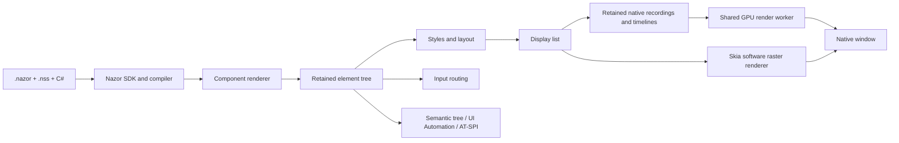

# 31. Architecture and extension points

## Pipeline and trees

Razor compilation creates C# component render methods and compiled NSS registrations. The component renderer reconciles its render output into retained element/text nodes. Component identity and element identity are related but distinct: a component can create multiple elements or none.

The style engine matches global/scoped rules, computes inherited/custom values, and records invalidation effects. Layout measures text/content and computes logical geometry. The scene builds a graphics display list. Skia records it for GPU composition or rasterizes it into CPU pixels; the native window presents the result. Input hit testing and accessibility derive their own behavior from these retained structures.

The visual pipeline can run without a native window. A native host adds message processing, frame presentation, text input, clipboard, platform preferences, and desktop services.

Native hosts default to `AUTO`, which tries hardware Skia and falls back to CPU on recognized graphics failures. CPU presentation rasterizes a display list with Skia and submits pixels through the native surface. GPU presentation uses WGL on Windows or EGL/OpenGL ES on Wayland, X11 and DRM/KMS. The UI thread resolves components, styles and layout, reuses unchanged native drawing recordings and submits a complete resource-owning snapshot to the shared graphics worker. Each surface retains one active snapshot and at most one pending replacement. Replacing a pending frame forces a full repaint to preserve damage correctness. The worker operates on snapshots and owns its graphics resources. Native context and surface cleanup completes before window destruction. [Renderer policy](32-Support-and-Limitations.md#nss-and-rendering) · [Backend support matrix](32-Support-and-Limitations.md#backend-support-matrix)

Composition-only NSS motion captures detached transform/opacity timelines and can continue while the UI dispatcher is busy. Other animation work retains the ordinary UI pipeline. Headless image output remains deterministic software rendering. Platform drawing contracts do not reference Skia or Windows APIs; OpenGL window contexts are one explicit graphics contract rather than a requirement for future Metal implementations.

## Runtime package map

| Package | Responsibility |
| --- | --- |
| `Nazor.Core` | Component contracts, renderer, retained nodes, dispatcher, event/reference primitives, navigation, shared window contracts |
| `Nazor.Controls` | SDK-supplied neutral primitives, shared editing, composable behavior and neutral/unstyled sheets |
| `Nazor.Style` | Properties/values, compiled sheets, selectors, cascade, computed styles, style tracing |
| `Nazor.Animation` | Clocks, easing, transition/keyframe interpolation |
| `Nazor.Graphics` | Geometry, colors, display-list contracts, font/text interfaces |
| `Nazor.Layout` | Block/flex/grid measurement and arrangement |
| `Nazor.Presentation` | Scene orchestration, layout/style integration, display-list creation |
| `Nazor.Renderer.Skia` | Raster rendering, Skia font loading, HarfBuzz shaping; namespaces include Nazor.Skia |
| `Nazor.Input` | Focus, pointer/keyboard routing, editing, scrolling, and input behavior |
| `Nazor.Accessibility` | Semantic nodes, roles, states, actions, announcements |
| `Nazor.Application` | Shared application/window lifetime, services, hosted app integration, development channel |
| `Nazor.Platform` | Backend/window/input/desktop integration contracts |
| `Nazor.Platform.Windows` | Win32 backend, OS integration, UI Automation provider |
| `Nazor.Platform.Linux` | Independent Wayland/X11 bridges, shared Linux desktop integration and explicit DRM/KMS single-view host; see [DRM architecture](34-Linux-DRM.md) |
| `Nazor.Hosting.Desktop` | Portable desktop runtime backend selection for Windows and Linux Wayland/X11 |
| `Nazor.Hosting.Desktop.Windows`, `Nazor.Hosting.Desktop.Linux` | The same `DesktopPlatformHost` API with the backend for the selected publish RID |
| `Nazor.Hosting.Windows` | Explicit Windows startup |
| `Nazor.Diagnostics` | Explicitly referenced inspection sessions, stable IDs, overlays and frame history; supports direct/headless use |
| `Nazor.DevTools.Agent` | Optional application-to-Diagnostics attachment; owns window inspection input, overlays and frame-history integration |
| `Nazor.DevTools.Protocol` | Detached inspection data contracts and .NET transport for local tools and debugger adapters |
| `Nazor.Themes.Fluent` | Optional WinUI-inspired theme over Basic |
| `Nazor.Themes.NazorLeaf` | Optional NazorLeaf theme, fonts, texture, and theme-specific controls |

The [API reference](../API.md) lists the public and protected members by package. `Nazor.Sdk` supplies MSBuild integration, and `Nazor.Templates` supplies `dotnet new` templates. The build-time compilers, grammars and editor extensions live in `Sources/Tools`. [Projects and builds](03-Projects-and-Builds.md)

`Nazor.Application` and the lower runtime graph have no Diagnostics, DevTools or IDE SDK dependency. The optional Agent depends on Application and Diagnostics; it uses the window's neutral `IWindowInstrumentation`, `WindowFrameMetrics` and `WindowFrameCause` contracts. Without an attachment those hooks collect no metrics and preserve ordinary input. The [standalone inspector](../DevTools.md) uses the ordinary runtime without acquiring an Agent through its own window host; its framework-dependent payload is bundled in the optional Agent package. See [window inspection](27-Testing-and-Diagnostics.md#window-inspection). The development Hot Reload channel is independently activated by its application setting or environment variable.

## Build and tooling boundary

The SDK generates project response files for normal compilation, watcher refresh, and editor Roslyn inputs. Desktop executables also receive a [platform bootstrap](03-Projects-and-Builds.md#automatic-platform-bootstrap) that registers `DesktopPlatformHost` before neutral application startup. That host detects the OS when run and delegates to an implemented backend; shared libraries do not register hosts. The language server consumes evaluated references and in-memory editor text; diagnostics map generated locations back to source. The development channel applies stylesheet replacements and inspects running windows. .NET hot reload applies supported code deltas.

Changing SDK/Razor/Roslyn integration can affect generated source, mappings, editor behavior, and package consumers together. Test through an external SDK consumer as well as source-project builds when changing that boundary.

## Extension points

Applications normally extend through reusable components, services, themes, and assets. Specialized controls can build render trees and publish element semantics. A custom host implements platform contracts and owns dispatcher startup plus window creation; it is responsible for reporting capabilities and environment rather than pretending every feature is available.

Font and drawing contracts are separate from startup registration. A renderer extension must satisfy measurement, shaping, display-list, DPI, and resource-lifetime expectations. Headless scenes are the smallest useful place to test such work.

These are extension contracts, not evidence that another production backend or renderer is provided. See [support](32-Support-and-Limitations.md).

---

[Guide index](README.md) · [API reference](../API.md)
