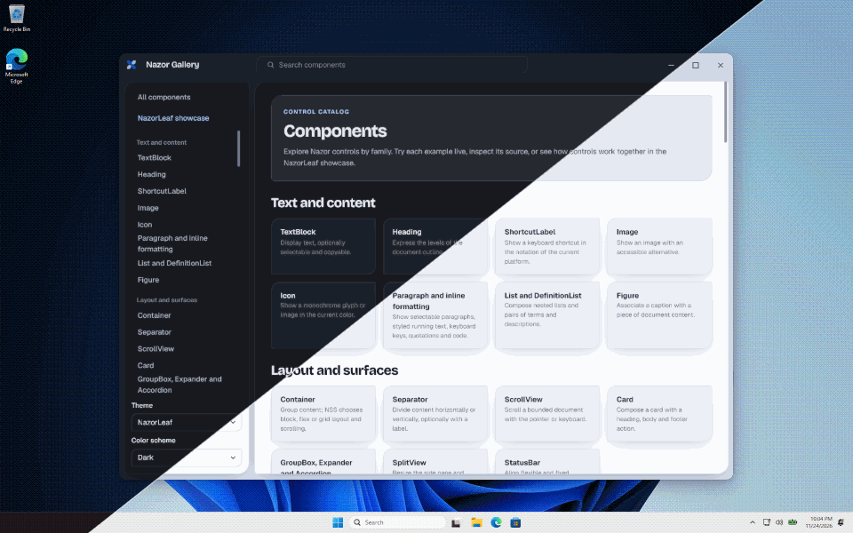

<h1></h1>

**Nazor stands for Native-Bl/Razor.** Build cross-platform .NET desktop apps with Razor syntax and a Blazor-inspired component model. Nazor opens native windows, aligns layouts to physical pixels, and draws its own controls without a WebView or a wrapper around another UI framework.

Nazor will always be free to use and open source. That commitment covers the framework, its tools, and everything I release from this repository.

> **`0.1.2-alpha` is an early preview for experiments and prototypes.** Expect changes to the APIs, markup, styling, and tooling.

[Website source](Webpage/README.md) · [Create an app](#try-the-preview) · [NuGet packages](Docs/NuGet.md#nuget-packages) · [Visual Studio Marketplace](https://marketplace.visualstudio.com/items?itemName=Noyzone99.nazorvisualstudio) · [Try the Gallery](#try-the-gallery) · [Discussions](https://github.com/noyzone99/Nazor/discussions) · [Report an issue](https://github.com/noyzone99/Nazor/issues)

## A quick look at the code

A `.nazor` component puts Razor markup, C# state, and scoped NSS in one file. Pressing the button updates the count and Nazor re-renders the component.

```razor
<Container Class="counter">
    <TextBlock>Count: @count</TextBlock>
    <Button OnClick="Increment">Increment</Button>
</Container>

@code {
    private int count;
    private void Increment() => count++;
}

@style {
    .counter { display: flex; flex-direction: column; gap: 8px; padding: 16px; }
}
```

[Run the Counter sample](Samples/Nazor.Samples.Counter/README.md)

## One app, at home on every desktop

A Nazor app can run in a native window on Windows 11, KDE Plasma and GNOME. The preview shows the same interface in light and dark, with window controls that match each desktop.



## Try the Gallery

The Nazor Gallery is a searchable, interactive catalog of ready-to-use controls and lower-level primitives. Try buttons, pickers, data grids, navigation, layout, and overlays, then inspect the Razor source beside each live example. Switch themes and color schemes in the same app, or open the NazorLeaf showcase to see how the controls work together in a complete interface.

[Download the Gallery from GitHub Releases](https://github.com/noyzone99/Nazor/releases). Choose a release with a `Nazor.Gallery-portable.zip` asset, extract the archive, and install the [.NET 10 Runtime](https://dotnet.microsoft.com/download/dotnet/10.0) if needed. Open a terminal in the extracted folder and run:

```sh
dotnet Nazor.Samples.Gallery.dll
```

The portable build selects the Windows backend on Windows x64 and the Wayland or X11 backend on supported Linux desktops. On a Linux machine configured for direct display access, run the same Gallery from a local console with:

```sh
dotnet Nazor.Samples.Gallery.dll --drm
```

DRM/KMS runs the catalog in one fullscreen view. Use **Exit Gallery** to return to the console. Separate-window previews require a desktop session. [Linux desktop prerequisites](Docs/Guide/33-Linux-Wayland.md#runtime-dependencies) · [X11 prerequisites](Docs/Guide/35-Linux-X11.md#system-dependencies-and-behavior) · [DRM/KMS prerequisites](Docs/Guide/34-Linux-DRM.md#runtime-dependencies-and-local-session) · [Build from source](#build-and-run-from-source)

## Why I started Nazor

I started Nazor because I wanted to write a desktop window the way I write a Blazor component. I wanted to compose the UI from small, reusable pieces, keep state close to the controls that use it, and put application logic in ordinary .NET services. I also wanted the result to feel at home on the desktop, with native windows, familiar keyboard behavior, and access to platform services.

Blazor inspired the component model. Avalonia inspired the separation between platform integration and a shared UI renderer. [Concepts for Razor and Avalonia developers](Docs/Guide/01-Introduction.md#concepts-for-razor-and-avalonia-developers)

## From the native window to the smallest detail

- **Native windows without a WebView.** Nazor's platform backends handle the OS window, input, and desktop services. Nazor draws its own controls with Skia and shapes text with HarfBuzz. The control tree runs without wrapped OS widgets. A shared layout engine snaps box edges to physical pixels, and the shared renderer gives controls a consistent look across supported backends. DPI, fonts, and native window chrome can still vary by platform. [Architecture overview](Docs/Guide/31-Architecture-and-Extension-Points.md)
- **Razor syntax and CSS-inspired styling.** Write `.nazor` components with C# and style them with NSS, Nazor's stylesheet language. App UI authoring needs no XAML. Use shared stylesheets for app-wide design tokens and scoped styles for an individual component. [Components and Razor](Docs/Guide/05-Components-and-Razor.md) · [NSS property reference](Docs/Guide/19-NSS-Property-Reference.md)
- **Your look, on any desktop.** NazorLeaf is the identity Nazor was designed with. Desktop-inspired themes reproduce Fluent, Adwaita, Breeze, Windows 9x, Windows XP, Windows 7 and CDE, and your own NSS can define a theme of its own. A theme is a look, not a platform requirement: each one runs on every supported backend. Basic ships with the SDK, and the Gallery lets you switch themes live. Keep the system frame, compose your own title bar and frame where the backend supports it, or customize individual control parts with NSS. [Window customization](Docs/Guide/14-Title-Bars-and-Platform-Integration.md) · [Styling and themes](Docs/Guide/16-Styling-and-Themes.md)
- **Native AOT support.** Publish Nazor desktop apps for Windows x64 and Linux x64 as native executables. They can run without a separate .NET runtime installation. [Native AOT deployment](Docs/Guide/28-Libraries-Packaging-and-Deployment.md#native-aot)

## What I'm working toward

The goal is to make that freedom practical for a small utility or a larger desktop app. Compose a new control from layout and interaction primitives, or start with ready-to-use editors, menus, lists, and tables. Headless tests and DevTools already let you inspect what a component renders, how it lays out, and which styles apply. [Control catalog](Docs/Guide/09-Control-Catalog.md) · [DevTools](Docs/DevTools.md)

Windows 10 and 11 x64 are the primary verification baseline. Linux has Wayland and X11 desktop backends and a DRM/KMS single-view host for embedded systems. Platform features and verification vary by backend. macOS, Android, and iOS are longer-term targets, along with .NET Framework 4.7.2 (`net472`) compatibility for Windows desktop applications. [Support and limitations](Docs/Guide/32-Support-and-Limitations.md)

You can run the visual regression tests and benchmarks yourself. The Windows comparison runs the same text, paint, and layout workloads in Nazor and Avalonia, with CPU and GPU runs, screenshot checks, and raw results. The protocol describes what those measurements cover. [Testing and benchmarks](Docs/Guide/27-Testing-and-Diagnostics.md#contributor-checks) · [Renderer comparison](Tests/RendererComparison/README.md)

## Help shape the first release

I build Nazor on my own, outside working hours, just for fun. Getting it stable enough for the first real apps is hard work, especially when it comes to keyboard input, accessibility, rendering, and the differences between desktops. Feedback from people trying Nazor on their own machines will help it mature faster.

Ask questions, request features, share what you're building, or talk about where Nazor should go next. [Join GitHub Discussions](https://github.com/noyzone99/Nazor/discussions)

Running the Gallery for a few minutes is already a contribution. If a control behaves oddly or the Gallery fails to start, open an issue with the release, your OS and backend, what you tried, and what happened. [Open an issue](https://github.com/noyzone99/Nazor/issues/new)

### Help bring Nazor to macOS

macOS support is planned. I don't have access to a Mac, so I can't test Nazor on macOS myself. How Nazor looks and feels on each desktop matters to me. Before announcing official support, I want to verify text rendering, display scaling, light and dark themes, and native window behavior on real Macs.

If you have a Mac, I'd love to have you contribute. You can help build the macOS backend or test early builds as they become available. [Introduce yourself in GitHub Discussions](https://github.com/noyzone99/Nazor/discussions)

## Try the preview

With the .NET 10 SDK installed and NuGet.org enabled, run these commands from an empty directory outside the Nazor checkout.

```powershell
dotnet new install Nazor.Templates@0.1.2-alpha
dotnet new nazor-app -n HelloNazor
dotnet run --project HelloNazor
```

In Visual Studio 2022 or 2026, install **Nazor for Visual Studio** and choose **Nazor application** from **Create a new project**. Choose a framework and theme, enter the application ID, and opt in to sample pages or DevTools. [Visual Studio Marketplace](https://marketplace.visualstudio.com/items?itemName=Noyzone99.nazorvisualstudio) · [Getting started](Docs/Guide/02-Getting-Started.md)

## Build and run from source

On Windows x64, install the .NET SDK pinned in [`global.json`](global.json) (`10.0.404`) and .NET SDK `11.0.100` for the Razor and C# language services. Clone this repository and run the following from its root. Building the Gallery also builds the framework projects it uses.

```powershell
dotnet build Samples/Nazor.Samples.Gallery -c Release
dotnet run --project Samples/Nazor.Samples.Gallery -c Release --no-build
```

On Linux, follow the [native build prerequisites](Docs/Guide/33-Linux-Wayland.md#build-from-source). See the [Gallery README](Samples/Nazor.Samples.Gallery/README.md) for launch options and portable packaging.

[Developer guide](Docs/Guide/README.md) · [API reference](Docs/API.md) · [MIT license](LICENSE)
