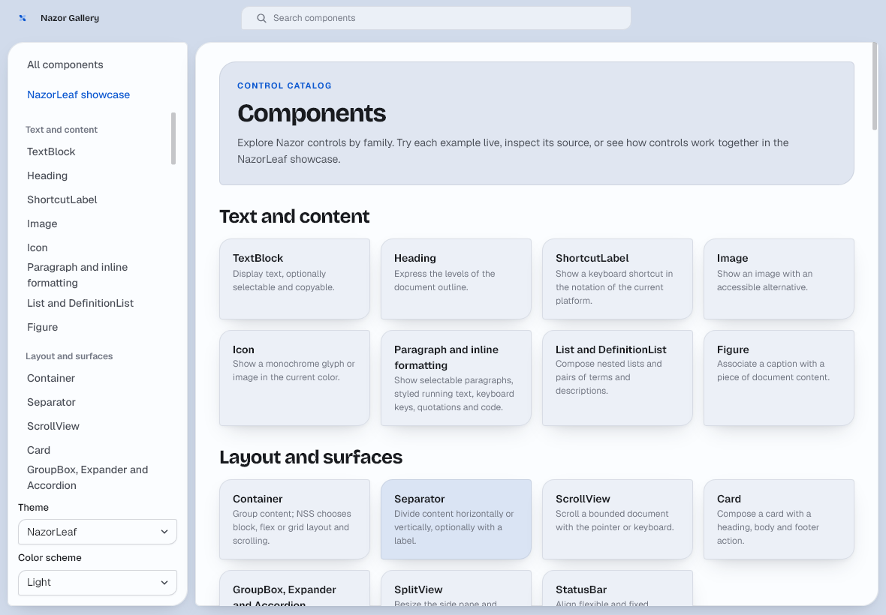

# Nazor for Visual Studio

Build native .NET desktop apps with Razor components and NSS, Nazor's CSS-inspired stylesheet language. Nazor uses native windows and draws its controls with a shared renderer. It is free and open source under the MIT license. [Nazor on GitHub](https://github.com/noyzone99/Nazor)

**Nazor 0.1.1-alpha is an early preview for experiments and prototypes.** The extension supports Visual Studio 2022 and Visual Studio 2026 on x64.

## What you get

- **Project and item templates.** Start from **Nazor application** in **Create a new project**. Choose the target framework, theme, and application ID. Add sample pages to explore navigation and reactive state. Include DevTools to inspect the app in Debug. Add components and stylesheets through **Add New Item** or **Quick Add**.
- **Support for Razor components and NSS.** Get syntax highlighting, completion, diagnostics, hover, formatting, and source navigation for `.nazor` and `.nss` files. The bundled language server includes C# 15 language services for Razor components and runs on .NET 10 LTS.
- **Hot Reload and inspection.** Work on a running app with Hot Reload. In an app configured for DevTools, press **F12** in its window to inspect the component tree, styles, and layout.

## Try it

Install the .NET and ASP.NET Core 10 runtimes and keep NuGet.org enabled in Visual Studio. The extension provides the project template, and Visual Studio restores the SDK, runtime, and any optional theme or DevTools packages from NuGet.org. [Nazor.Sdk on NuGet](https://www.nuget.org/packages/Nazor.Sdk/0.1.1-alpha) · [Getting started](https://github.com/noyzone99/Nazor/blob/main/Docs/Guide/02-Getting-Started.md) · [Editor guide](https://github.com/noyzone99/Nazor/blob/main/Docs/Guide/26-Editors-and-Hot-Reload.md) · [Report an issue](https://github.com/noyzone99/Nazor/issues)

## Nazor Gallery

The Gallery is a runnable app that lets you explore the controls and see the components and styles behind them.

[Try the Gallery](https://github.com/noyzone99/Nazor#try-the-gallery)
